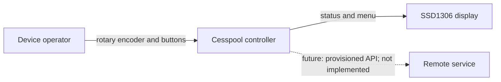
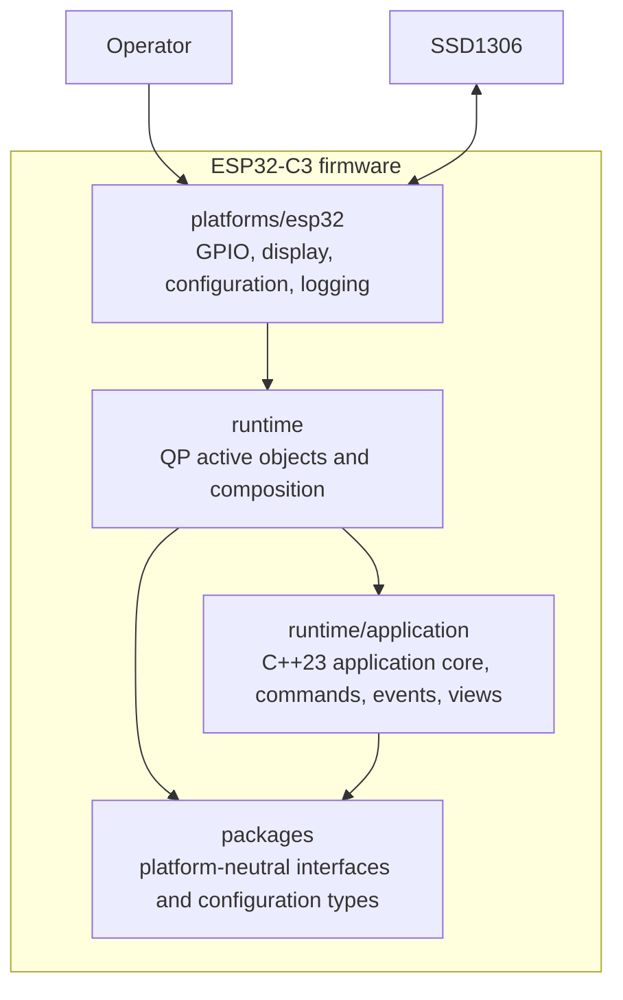

# Architecture

## C4 context

## C4 containers

`App` initializes QP and delegates startup to `SystemOrchestrator`. The orchestrator owns the
application core and wires static ports and active objects. Application decisions live in
`runtime/application`; platform implementations stay under `platforms/`.

The application core uses fixed-size values and buffers. This does not establish a whole-firmware
no-allocation guarantee: IDF and third-party component internals still need measurement.

## Current limitations

- The menu and in-memory event/read-model foundation exist; persistence, remote provisioning, and
  event storage/replay across reboot do not.
- The STM32 target is compile-only and does not provide platform adapters.
- ESP-IDF local installation is `v6.1-dev-7308-g0276131402f`, while `dependencies.lock` records
  IDF `6.2.0`. Resolve this mismatch before treating either version as the production baseline.
- Wokwi CI, signed OTA, certificate pinning, secure boot, flash/NVS encryption, core-dump
  collection, and production size/stack budgets are not yet qualified.
